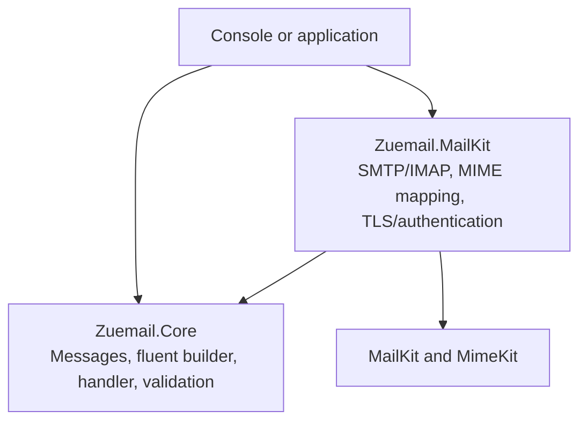
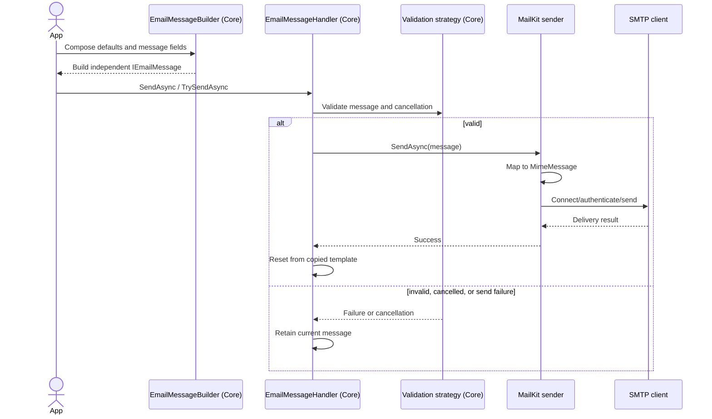
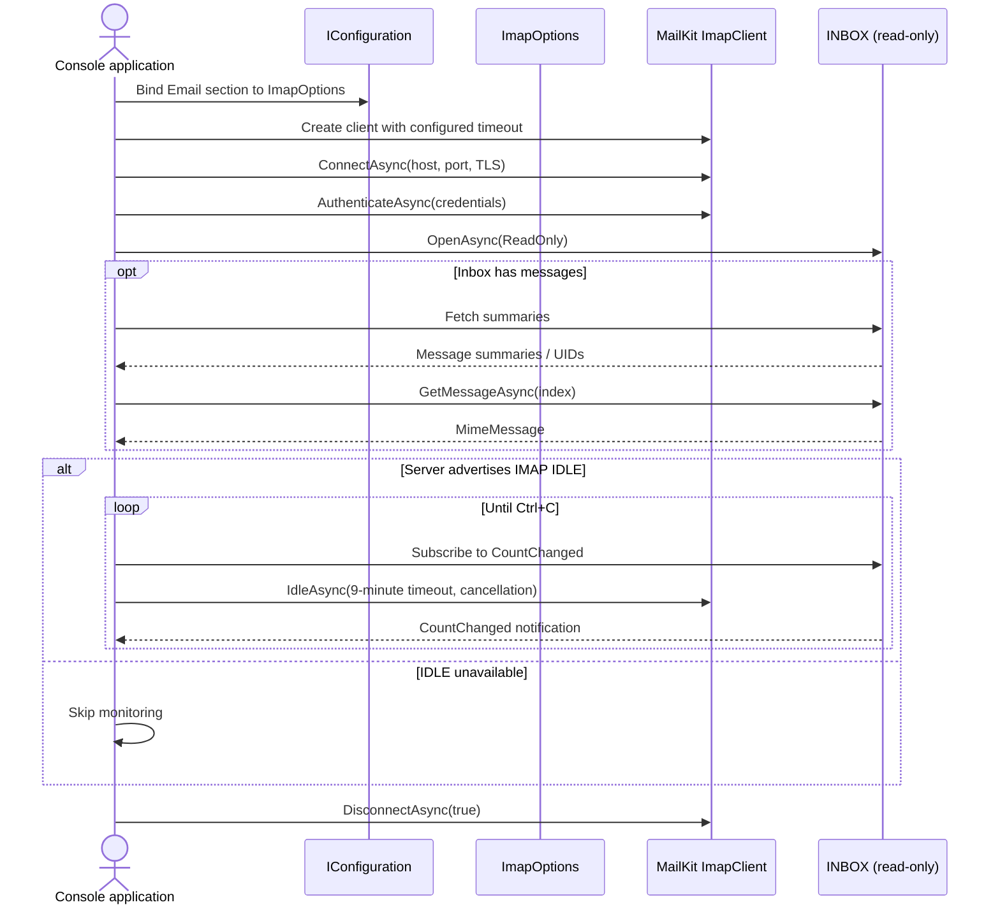

# Zuemail Architecture

## Project Dependencies

Core defines the message model and fluent/send abstractions. The MailKit project implements transport integration against those Core contracts. Applications compose the projects and provide configuration. Core must not depend on MailKit or MimeKit.

## Compose and Send

Composition is synchronous and transport-free. The handler validates before invoking the sender. A successful send resets the working message from a copied template; unsuccessful or cancelled sends retain the message for inspection or retry.

## Connect and Monitor IMAP

The current console sample owns an `ImapClient` directly: it binds `ImapOptions`, connects and authenticates, opens INBOX read-only, fetches summaries/messages, and uses IDLE only when the server advertises that capability. IDLE is renewed periodically and Ctrl+C cancels the wait. There is not currently a Zuemail IMAP receiver/monitor abstraction; this diagram describes the sample's direct MailKit flow.

## Design Patterns in Use

- **Builder:** `EmailMessageBuilder` gathers message fields through fluent methods. `Compose(Action<IEmailMessageBuilder>)` applies reusable defaults, and `Build()` returns a detached message without sending.
- **Prototype-style copying and templates:** `EmailMessage.Copy()` and builder `Copy()` create independent working state. `SaveAsTemplate()` preserves reusable defaults; the handler starts/reset messages from copies. Collections, contacts, and byte arrays are copied, while legacy streams and other objects remain borrowed references.
- **Strategy:** `IValidationStrategy<IEmailMessage>` allows validation to be supplied independently of the handler. `EmailMessageValidator` is the default; `ICancellableValidationStrategy<T>` adds cancellation without breaking legacy strategies.
- **Adapter:** `EmailMessageConverter` maps Core messages to/from MimeKit types. `MailKitSmtpSender` adapts the generic sender contract to SMTP transport. IMAP currently uses MailKit directly in the console, so an IMAP receiver adapter is not yet present.
- **Options/configuration:** `EmailOptions`, `SmtpOptions`, and `ImapOptions` separate neutral connection values from MailKit-specific TLS, capabilities, and protocol behavior. Configuration binding happens in the application composition root.
- **Dependency injection / composition root:** the console chooses options, validators, loggers, and provider clients. Core contracts do not depend on the MailKit project; the provider references Core.
- **Resource ownership:** `using`/`Dispose` and `await using`/`IAsyncDisposable` scope network clients and messages. This is deterministic resource management, not connection pooling; pooling is not currently implemented.

Retries, decorators, channel-backed queues, durable outbox processing, and an IMAP receiver abstraction are not represented as implemented patterns. They remain optional future work when concrete usage requires them.

## Ownership Boundaries

- Core owns generic message composition, copy/template behavior, and validation contracts. Its builder does not connect or send.
- MailKit owns MIME conversion and protocol-specific SMTP/IMAP behavior. Provider settings include TLS, authentication capabilities, and protocol logging.
- The application owns configuration and chooses when to call a sender. Avoid sharing mutable templates between independent handlers; builders copy configured templates.
- Message copies clone collections, contacts, and byte-array attachments. Legacy streams and arbitrary non-byte attachment values remain borrowed references.
- The console project is an example composition root, not another library layer.
