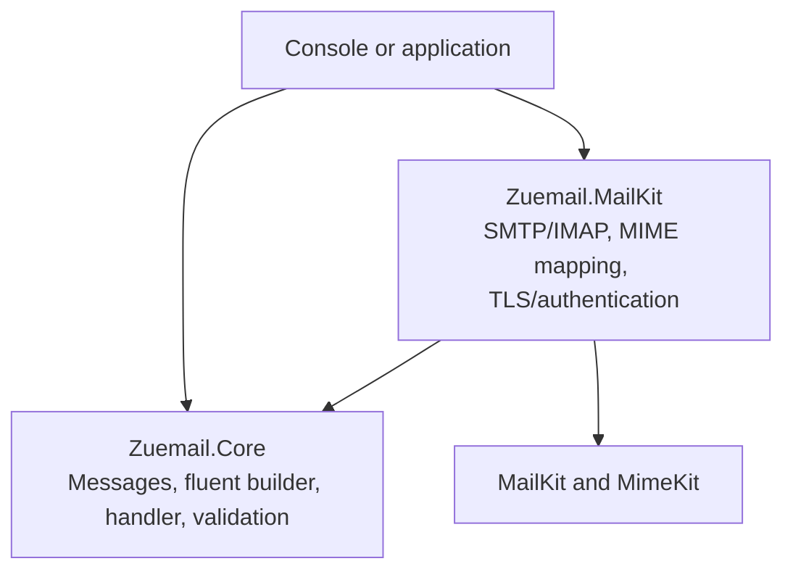
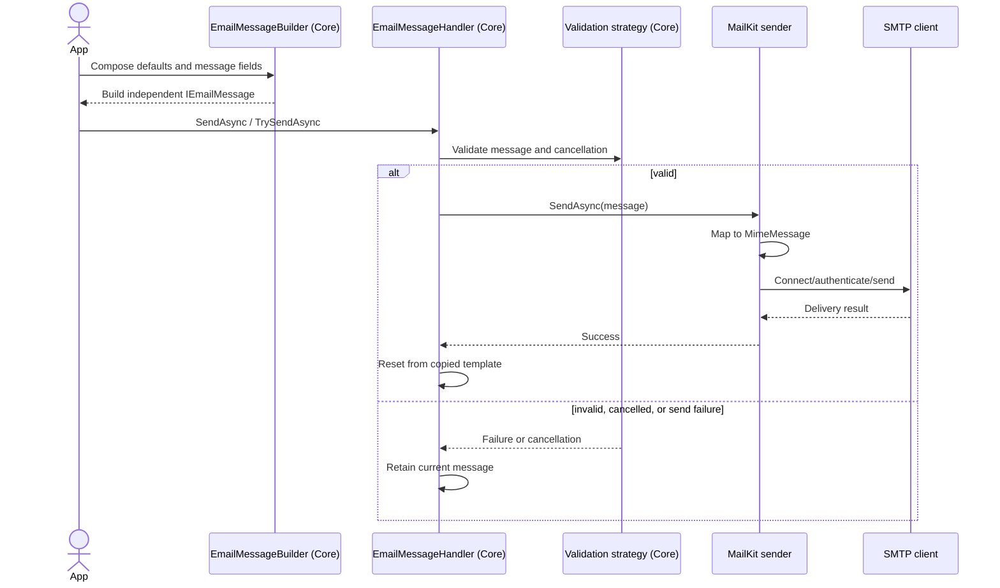
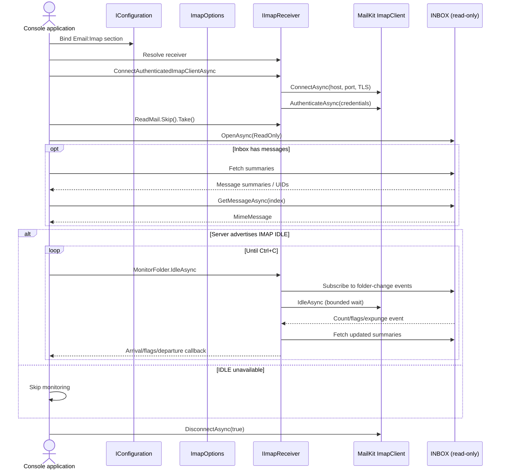

# Zuemail Architecture

## Project Dependencies

Core defines the message model and fluent/send abstractions. The MailKit project implements transport integration against those Core contracts. Applications compose the projects and provide configuration. Core must not depend on MailKit or MimeKit.



## Compose and Send

Composition is synchronous and transport-free. The handler validates before invoking the sender. A successful send resets the working message from a copied template; unsuccessful or cancelled sends retain the message for inspection or retry.



## Connect and Monitor IMAP

The console uses `IImapReceiver` to connect/authenticate and provides a fluent reader, folder client, and event-based monitor. The reader fetches INBOX summaries/messages with read-only folder access. The monitor uses IDLE only when the server advertises that capability, renews the IDLE wait, falls back to NOOP polling when IDLE is unavailable, dispatches arrivals/flag changes/departures, and supports cancellation/reconnect retries.



## Design Patterns in Use

- **Builder:** `EmailMessageBuilder` gathers message fields through fluent methods. `Compose(Action<IEmailMessageBuilder>)` applies reusable defaults, and `Build()` returns a detached message without sending.
- **Prototype-style copying and templates:** `EmailMessage.Copy()` and builder `Copy()` create independent working state. `SaveAsTemplate()` preserves reusable defaults; the handler starts/reset messages from copies. Collections, contacts, and byte arrays are copied, while legacy streams and other objects remain borrowed references.
- **Strategy:** `IValidationStrategy<IEmailMessage>` allows validation to be supplied independently of the handler. `EmailMessageValidator` is the default; `ICancellableValidationStrategy<T>` adds cancellation without breaking legacy strategies.
- **Adapter:** `EmailMessageConverter` maps Core messages to/from MimeKit types. `MailKitSmtpSender` adapts `IEmailSender<IEmailMessage>` to SMTP. `ImapReceiver` adapts configured account operations to MailKit client/folder calls.
- **Facade and modular services:** `IImapReceiver` coordinates connection/authentication and exposes separate `IMailReader`, `IMailFolderClient`, and `IMailFolderMonitor` services. The receiver owns client lifecycle; readers, folder operations, and monitoring remain independently testable.
- **Fluent query object:** `MailFolderReader` composes `Top`, `Skip`, `Take`, `Range`, `Query`, and `Items`, then executes retrieval explicitly. It owns selection state, not the receiver's client.
- **Observer:** `MailFolderMonitor` subscribes to MailKit folder events and dispatches arrival, flag-change, and departure callbacks. It uses IDLE with a polling fallback and handles cancellation/reconnection.
- **Options/configuration:** `EmailOptions`, `SmtpOptions`, and `ImapOptions` separate neutral connection values from MailKit-specific TLS, capabilities, and protocol behavior. The composition root binds `Email:Smtp` and `Email:Imap` separately; DI extensions configure and register provider services.
- **Dependency injection / composition root:** the console chooses options, validators, loggers, and provider clients. Core contracts do not depend on the MailKit project; the provider references Core.
- **Resource ownership:** `IImapReceiver` owns a client it creates but does not dispose an injected client. Reader copies and monitors use cloned receivers; callbacks run outside Core. SMTP follows the same owned-versus-injected-client rule. This is deterministic resource management, not connection pooling.
- **Symmetric provider lifecycle:** SMTP and IMAP options expose fresh client factories, use the shared MailKit connect/auth helper where applicable, bind from separate nested sections, and offer matching DI registration. Each protocol has a small owner service rather than sharing mutable connected-client state.

SMTP and IMAP now share provider options, client factories, connection/authentication helpers, typed capability delegates, DI registration, cancellation, and explicit client ownership. They retain protocol-specific services instead of forcing SMTP/IMAP into one large abstraction. Retry behavior currently belongs to IMAP monitoring; generic SMTP retries, decorators, channel-backed queues, and durable outbox processing remain optional future work.

### Settings Shape

```json
{
    "Email": {
        "Smtp": {
            "Host": "localhost",
            "Port": 25
        },
        "Imap": {
            "Host": "localhost",
            "Port": 143,
            "MailFolderName": "INBOX"
        }
    }
}
```

`SmtpOptions.SectionName` and `ImapOptions.SectionName` point to these nested sections. `ConfigureSmtp()`/`ConfigureImap()` and `AddZuemailSmtpSender()`/`AddZuemailImapReceiver()` provide the equivalent DI setup.

## Test Boundaries

- `Zuemail.Core.Tests` tests only Core message, builder, handler, and validation behavior; it references Core alone.
- `Zuemail.MailKit.Tests` tests SMTP/IMAP adapters, options/configuration, and MailKit client/folder lifecycle; it references the provider project.
- Both are executable xUnit projects on Microsoft.Testing.Platform, keeping transport mocks and MailKit packages out of Core tests.

## Ownership Boundaries

- Core owns generic message composition, copy/template behavior, and validation contracts. Its builder does not connect or send.
- MailKit owns MIME conversion and protocol-specific SMTP/IMAP behavior. Provider settings include TLS, authentication capabilities, and protocol logging.
- The application owns configuration and chooses when to call a sender/receiver. Avoid sharing mutable templates between independent handlers; builders copy configured templates.
- Message copies clone collections, contacts, and byte-array attachments. Legacy streams and arbitrary non-byte attachment values remain borrowed references.
- The console project is an example composition root, not another library layer. It binds SMTP and IMAP settings separately and uses the Zuemail IMAP receiver abstraction rather than handling raw IMAP client lifecycle itself.
